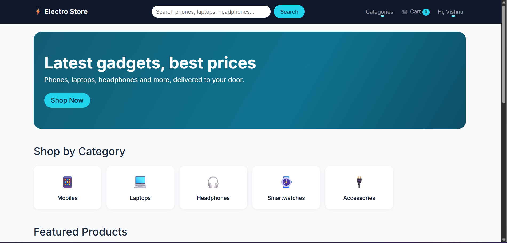
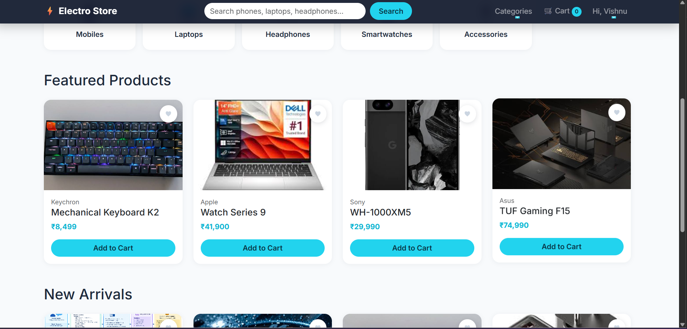
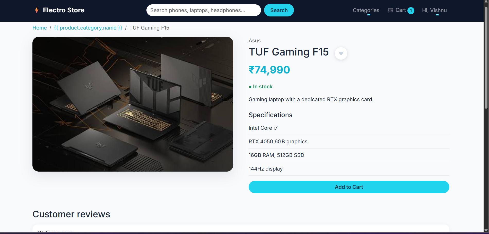
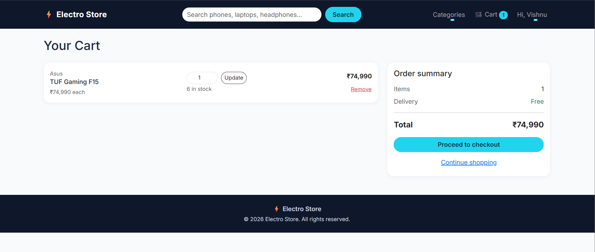
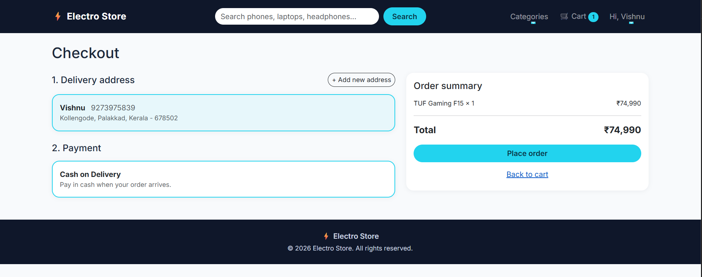

# Electro Store: Django E-commerce

A full-stack electronics e-commerce website built with Django.
**Live demo:** https://ecommercepractice.onrender.com
(Free hosting, so the first load after inactivity can take about a minute.)

## Features
- Sign up, login, logout, profile and saved delivery addresses
- Product catalogue with categories, search, brand and price filters, sorting and pagination
- Cart with quantity update and live item count in the navbar
- Checkout with a saved address, Cash on Delivery, and stock check and reduction
- Order history, order detail with a status tracker, and cancel while Placed (stock restored)
- Wishlist and product reviews (one review per user per product, average rating)
- Custom 404 and 500 pages, and a responsive layout
- Admin updates order status: Placed, Shipped, Out for delivery, Delivered or Cancelled

## Tech stack
Python, Django, SQLite (local) and PostgreSQL (production), Bootstrap, HTML, CSS, JavaScript,
Gunicorn, WhiteNoise, Render

## Screenshots
| Home | Products |
|---|---|
|  |  |
| **Product detail** | **Cart** |
|  |  |
| **Orders** | |
|  | |

## What I learned
- Custom user model, ModelForms and class-free function views
- Database design with foreign keys, snapshots of price and address in orders
- Atomic transactions so stock and orders never go out of sync
- Ownership checks so users can only access their own data
- 73 automated tests, and production settings and deployment

## Run locally
```
git clone https://github.com/vishnu-jd777/ecommerce.git
cd ecommerce
python -m venv myvenv
myvenv\Scripts\activate
pip install -r requirements.txt
python manage.py migrate
python manage.py seed_products
python manage.py runserver
```
Create a `.env` file with `SECRET_KEY=...` and `DEBUG=True`.

## Known limitations
- Cash on Delivery only (no online payment)
- Photos uploaded through the live admin are not permanent on the free host